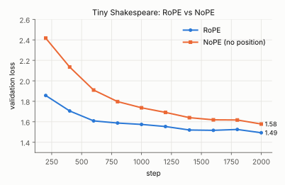

# Going further

You now have a complete, working LLM pipeline. The best way to understand why each piece is there is to remove or change it, and measure.
Here are some experiments and extensions, roughly in order of increasing effort.
For each experiment, keep the number of training steps fixed, compare **validation** losses, and write down what you did (a short experiment log is worth a lot).

!!! tip "Compare fairly"
    Use the same seed, the same number of steps and the same evaluation for all the runs of an experiment. Training curves are noisy: a difference of 0.01 in loss is probably not significant at this scale.
    To compare models with **different tokenizers**, convert the loss (in nats per token) into **bits per byte**: $\text{bpb} = \frac{\text{loss}}{\ln 2 \times \text{bytes per token}}$.

## Ablations

### No position embedding (NoPE)

Train without RoPE (`rope_theta=None`):

```bash
uv run easygpt train --preset shakespeare --no-rope --out checkpoints/shakespeare-nope.pt
```



*Validation loss on Tiny Shakespeare with RoPE and without any position information (NoPE).*

Surprisingly, it still learns quite well (validation loss 1.58 after 2000 steps, vs 1.49 with RoPE): a causal Transformer can infer positions by itself ([Kazemnejad et al., 2023](https://arxiv.org/abs/2305.19466)), e.g. by attending uniformly to all previous tokens, which produces a signal that decays like $1/t$.
But it learns much more slowly at the beginning, and stays behind. Why would knowing the *relative* position ("the previous character") matter so much for character-level modeling? Look at the attention patterns of [page 3](part1/attention.md): which heads would be hard to implement without position information?

### Normalization

1. **No RMSNorm.** Replace the three kinds of `RMSNorm` (`ln1`, `ln2`, `ln_final`) with the identity (`nn.Identity()`). What happens with the default learning rate? Can you recover stable training with a smaller one?
2. **Post-norm.** Change `TransformerBlock.forward` to the post-norm version of the [original Transformer](https://arxiv.org/abs/1706.03762):
   $z = \operatorname{RMSNorm}(x + \operatorname{MHA}(x))$, $y = \operatorname{RMSNorm}(z + \operatorname{FFN}(z))$. Compare the learning curves. Try with more layers (8 or 12).

### Gating

Replace `SwiGLU` with the non-gated $\operatorname{FFN}(x) = W_2\, \operatorname{SiLU}(W_1 x)$ with $d_\text{ff} = 4d$ (to keep roughly the same number of parameters). Is the gated version better at equal parameter count?

### Weight tying

GPT-2 and many small models **tie** the input embedding and the LM head ([Press & Wolf, 2017](https://arxiv.org/abs/1608.05859); `self.lm_head.weight = self.token_embeddings.weight`), which saves $Vd$ parameters (a lot for large vocabularies, but not much for us).
Implement it; you may need to reduce the standard deviation of the embedding initialization (why?).

## Hyperparameters

- **Learning rate sweep**: see [page 7](part1/training.md). Does the best learning rate change when you double `d_model`?
- **Batch size**: with a fixed budget of tokens, compare batch sizes 8, 32, 128.
- **Context length**: on TinyStories, compare $T = 64$, $128$, $256$: effect on the loss *and* on the time per step.
- **Vocabulary size**: train BPE tokenizers with 512, 1024, 2048 and 4096 tokens, train the same model on each and compare in bits per byte.
- **Width vs depth**: at a fixed number of parameters, is it better to have more layers or a larger `d_model`?

## A tiny scaling law

Train a family of models of increasing size on TinyStories (e.g. $d \in \{64, 96, 128, 192, 256\}$ with 4 layers and heads of dimension 32), with the same number of tokens, and plot the final validation loss against the number of non-embedding parameters on a log-log scale.
Is it close to a straight line? [Kaplan et al. (2020)](https://arxiv.org/abs/2001.08361) and [Hoffmann et al. (2022, "Chinchilla")](https://arxiv.org/abs/2203.15556) found such power laws over many orders of magnitude.

## Efficiency

- **`torch.compile`.** Measure the speed-up given by `--compile` on CPU (and on GPU).
- **Mixed precision** ([Micikevicius et al., 2018](https://arxiv.org/abs/1710.03740)). On a GPU, run the forward pass under `torch.autocast("cuda", dtype=torch.bfloat16)`. Where does the upcast of `RMSNorm` matter? Do you need it for the softmax as well?
- **KV cache** (see the diagrams of [KV Cache from scratch in nanoVLM](https://huggingface.co/blog/kv-cache)). In `generate`, the whole prefix is recomputed at each step. Store the keys and values of the previous positions in each attention layer and only compute the new position. Careful with RoPE: the new token must be rotated with its absolute position. Measure the speed-up for long generations.
- **Grouped-query attention.** [Llama 3](https://arxiv.org/abs/2407.21783) (and the largest [Llama 2](https://arxiv.org/abs/2307.09288) models) share the keys and values among groups of query heads ([GQA](https://arxiv.org/abs/2305.13245)), which shrinks the KV cache. Implement it with a `num_kv_heads` argument.

## Resource accounting

These questions (adapted from CS336) build the back-of-the-envelope skills used to plan real training runs. Assume float32.

1. For GPT-2 XL with our architecture ($V = 50\,257$, $T = 1024$, $L = 48$, $d = 1600$, $H = 25$, $d_\text{ff} = 4288$): number of parameters, and memory to store them.
2. FLOPs of a forward pass for a sequence of length $T$, broken down by component (attention projections, attention scores, feed-forward, LM head). Which part dominates? How does the breakdown change for GPT-2 small, medium, large? And for GPT-2 XL with $T = 16\,384$?
3. Peak memory for training with AdamW: parameters, gradients, optimizer state, and activations (as a function of the batch size). What is the largest batch size that fits in 80 GB for GPT-2 XL?
4. At 50% of the peak throughput of an H100 (about 495 TFLOP/s in TF32), how long would it take to train GPT-2 XL for 400K steps with a batch of 1024 sequences of $T = 1024$ tokens? (Use $6N$ FLOPs per token.)
5. Same questions for our `tinystories` preset on your laptop: measure the time per step and deduce the effective FLOP/s of your CPU.
