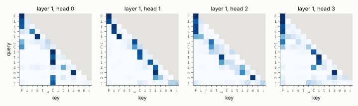

# 3. Self-attention

**Objective.** Let every position gather information from the previous ones with **causal self-attention**, the core of the Transformer.

## Mixing the past

The bigram model predicts $x_{t+1}$ from $x_t$ alone.
To use the whole prefix $x_{1:t}$, position $t$ needs a summary of positions $1, \dots, t$.
The crudest summary is an average: if $h_1, \dots, h_T \in \mathbb{R}^d$ are the vectors at the $T$ positions (e.g. the token embeddings), let

$$
z_t = \frac{1}{t} \sum_{s \leq t} h_s, \qquad\text{i.e.}\qquad Z = A H \quad\text{with}\quad A_{ts} = \begin{cases} 1/t & s \le t \\ 0 & s > t\end{cases}.
$$

The matrix $A$ is lower-triangular: position $t$ never looks at the future $s > t$ (it would be cheating, since $x_{t+1}$ is the target).
Each row $t$ is a probability distribution over the positions $s \le t$.

Instead of being fixed, the averaging weights should depend on the *content*: in "the cat ... it", the token "it" should look at "cat".
Attention computes them from the data: each position $t$ emits a **query** $q_t$ ("what am I looking for?"), a **key** $k_t$ ("what do I contain?") and a **value** $v_t$ ("what do I give if selected?").
The weight of $s$ for $t$ is large when $q_t$ and $k_s$ are aligned:

$$
A_{t s} = \frac{\exp(q_t^\top k_s / \sqrt{d_k})}{\sum_{s' \leq t} \exp(q_t^\top k_{s'} / \sqrt{d_k})} \quad (s \le t), \qquad z_t = \sum_{s \le t} A_{ts}\, v_s.
$$

## Scaled dot-product attention

In matrix form ([Vaswani et al., 2017](https://arxiv.org/abs/1706.03762)), with queries $Q \in \mathbb{R}^{n \times d_k}$, keys $K \in \mathbb{R}^{m \times d_k}$ and values $V \in \mathbb{R}^{m \times d_v}$,

$$
\operatorname{Attention}(Q, K, V) = \operatorname{softmax}\!\left(\frac{Q K^\top}{\sqrt{d_k}}\right) V \in \mathbb{R}^{n \times d_v},
$$

where the softmax is applied to each row.

**Why $\sqrt{d_k}$?** If the coordinates of $q$ and $k$ are independent with zero mean and unit variance, $q^\top k$ has variance $d_k$. Without the rescaling, the scores would have a standard deviation of $\sqrt{d_k}$: for large $d_k$ the softmax saturates (its output is almost one-hot), and its gradient vanishes.

**Masking.** A boolean mask $M \in \{\text{True}, \text{False}\}^{n \times m}$ says which keys each query may attend to (`True` = allowed).
We implement it by setting the forbidden scores to $-\infty$ *before* the softmax: $\exp(-\infty) = 0$, so the forbidden positions get exactly zero weight and the others still sum to one.
For language modeling we use the **causal mask** $M_{ts} = (s \le t)$, which is `True` on and below the diagonal.



*Attention weights of the four heads of one layer of the trained Shakespeare model of [page 7](training.md), on the input `"First Citizen:"`. Each row (query) is a distribution over the positions up to it (keys); the upper triangle is masked.*

!!! question "Exercise: `causal_mask` and `scaled_dot_product_attention`"
    In [`src/easygpt/attention.py`](https://github.com/svaiter/easygpt/blob/main/src/easygpt/attention.py), implement

    - `causal_mask(seq_len, device=None)`: the boolean `(seq_len, seq_len)` matrix with `True` on and below the diagonal (`torch.tril`, or compare `torch.arange` with itself using broadcasting);
    - `scaled_dot_product_attention(q, k, v, mask=None)` for inputs of shape `(..., n, d_k)`, `(..., m, d_k)`, `(..., m, d_v)`: any number of leading batch dimensions (batch, heads, ...) must work. Use `k.transpose(-2, -1)`, `masked_fill` and your own `softmax`.

## Multi-head self-attention

In **self**-attention, queries, keys and values are all computed from the same sequence $X \in \mathbb{R}^{T \times d}$ (one row per position) with learned projections:
$Q = X W_Q^\top$, $K = X W_K^\top$, $V = X W_V^\top$.

A single attention pattern per position is limiting: a token may need to look at the previous character *and* at the beginning of the current word.
**Multi-head** attention runs $H$ attentions (the *heads*) in parallel, on slices of dimension $d_h = d / H$, and concatenates the results:

$$
\operatorname{MHA}(X) = \operatorname{Concat}(\text{head}_1, \dots, \text{head}_H)\, W_O^\top, \qquad \text{head}_i = \operatorname{Attention}(Q_i, K_i, V_i),
$$

where $Q_i \in \mathbb{R}^{T \times d_h}$ is the $i$-th block of $d_h$ columns of $Q$ (same for $K_i$, $V_i$), and $W_Q, W_K, W_V, W_O \in \mathbb{R}^{d \times d}$.
Note that we do **not** loop over heads: we compute $Q$ with one matrix product, then *reshape* it so that heads become a batch dimension, and let `scaled_dot_product_attention` (which accepts any leading dimensions) do all heads at once.

```text
x                     (B, T, D)
q = q_proj(x)         (B, T, D)
q.view(B, T, H, Dh)   (B, T, H, Dh)    split the last dim into H heads of size Dh = D / H
 .transpose(1, 2)     (B, H, T, Dh)    heads become a batch dimension
attention(q, k, v)    (B, H, T, Dh)
 .transpose(1, 2)     (B, T, H, Dh)
 .reshape(B, T, D)    (B, T, D)        concatenate the heads
output_proj(...)      (B, T, D)
```

!!! question "Exercise: `MultiHeadSelfAttention`"
    Implement `MultiHeadSelfAttention` in [`src/easygpt/attention.py`](https://github.com/svaiter/easygpt/blob/main/src/easygpt/attention.py):

    - `__init__`: four `Linear(d_model, d_model)` named `q_proj`, `k_proj`, `v_proj`, `output_proj` (`self.rope` is given: ignore it until [page 4](rope.md));
    - `forward(x, token_positions=None)`: `x` has shape `(B, T, D)`; compute the projections, split the heads, apply causal attention, merge the heads, project.

    Leave a placeholder for RoPE: on the next page you will add two lines applying `self.rope` to queries and keys when it is not `None`.

Validate with `uv run pytest tests/test_attention.py`.

!!! tip "Debugging shapes"
    Most bugs here are shape bugs that do not crash: `view(B, H, T, Dh)` instead of `view(B, T, H, Dh).transpose(1, 2)` runs fine but mixes positions and heads.
    The test `test_mha_matches_reference` compares with a loop over heads; `test_mha_is_causal` checks that changing future tokens does not change past outputs.

!!! tip "Visual explanations"
    - 3Blue1Brown, [Attention in transformers, step-by-step](https://www.3blue1brown.com/lessons/attention): queries, keys, values, masking and multiple heads, animated.
    - Jay Alammar, [The Illustrated Transformer](https://jalammar.github.io/illustrated-transformer/), sections *Self-Attention in Detail* to *The Beast With Many Heads*: the computation for one position, then in matrix form, then with several heads.
    - [Transformer Explainer](https://poloclub.github.io/transformer-explainer/): type a sentence and inspect the attention weights of GPT-2.

## Questions

1. Without the causal mask, show that self-attention is **permutation-equivariant**: permuting the rows of $X$ permutes the rows of the output in the same way. What does this imply about the model's knowledge of word order? (With the causal mask the situation is more subtle: see the NoPE ablation in [Going further](../experiments.md).)
2. How many parameters does a multi-head attention layer have? Does it depend on the number of heads?
3. For a sequence of length $T$, what is the memory needed to store the attention weights of one layer, for a batch of size $B$ with $H$ heads? How does the cost of attention scale with $T$, compared with the cost of the projections?
