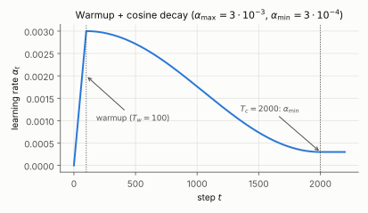

# 6. AdamW, schedule, clipping

**Objective.** Write the optimizer (AdamW), the learning-rate schedule (linear warmup + cosine decay) and the gradient clipping used to train LLMs.

## The `torch.optim.Optimizer` API

An optimizer holds a list of **parameter groups** (`self.param_groups`), each a dictionary with the parameters under `"params"` and the hyperparameters (`"lr"`, ...), and a per-parameter **state** (`self.state[p]`, a dictionary, initially empty).
Its `step()` method updates the parameters in place from their gradients `p.grad`, computed by `loss.backward()`.
The plain SGD update $\theta \leftarrow \theta - \alpha \nabla L(\theta)$ is given in [`src/easygpt/optim.py`](https://github.com/svaiter/easygpt/blob/main/src/easygpt/optim.py):

```python
class SGD(torch.optim.Optimizer):
    def __init__(self, params, lr=1e-3):
        super().__init__(params, defaults={"lr": lr})

    @torch.no_grad()  # the update itself must not be recorded by autograd
    def step(self, closure=None):
        loss = None if closure is None else closure()
        for group in self.param_groups:
            lr = group["lr"]
            for p in group["params"]:
                if p.grad is None:  # e.g. a frozen parameter
                    continue
                p -= lr * p.grad    # in place: p must stay the same tensor object
        return loss
```

The typical use is:

```python
optimizer = SGD(model.parameters(), lr=0.1)
for step in range(num_steps):
    loss = compute_loss(model, batch)
    optimizer.zero_grad()  # gradients accumulate otherwise
    loss.backward()
    optimizer.step()
```

## AdamW

Adam ([Kingma & Ba, 2015](https://arxiv.org/abs/1412.6980)) keeps two exponential moving averages per parameter: of the gradient $g$ (first moment, a "momentum") and of its square $g^2$ (second moment).
Each coordinate then moves by $\alpha\, m / \sqrt{v}$: roughly the sign of the recent gradients, with a step size that does not depend on the scale of the gradient.
This per-coordinate normalization matters a lot for Transformers, whose parameters (embeddings, norms, attention, ...) have gradients of very different magnitudes.

AdamW ([Loshchilov & Hutter, 2019](https://arxiv.org/abs/1711.05101)) adds **decoupled weight decay**: the weights are shrunk towards zero, $\theta \leftarrow (1 - \alpha\lambda)\theta$, separately from the gradient step (if you add $\frac{\lambda}{2}\|\theta\|^2$ to the loss instead, its gradient $\lambda\theta$ is rescaled by $1/\sqrt{v}$ like the rest of the gradient).

For each parameter $\theta$, with hyperparameters $\alpha$ (learning rate), $\beta_1, \beta_2$, $\varepsilon$, $\lambda$ (weight decay), and $m_0 = v_0 = 0$, at step $t = 1, 2, \dots$:

$$
\begin{aligned}
\theta &\leftarrow \theta - \alpha \lambda \theta && \text{weight decay} \\
m &\leftarrow \beta_1 m + (1 - \beta_1)\, g && \text{first moment} \\
v &\leftarrow \beta_2 v + (1 - \beta_2)\, g^2 && \text{second moment (element-wise square)} \\
\hat m &= m / (1 - \beta_1^t), \quad \hat v = v / (1 - \beta_2^t) && \text{bias corrections} \\
\theta &\leftarrow \theta - \alpha\, \hat m / (\sqrt{\hat v} + \varepsilon) && \text{update}
\end{aligned}
$$

The bias corrections compensate for the zero initialization: after one step, $m = (1 - \beta_1) g$ is much smaller than $g$, but $\hat m = g$.
Typical values: $\beta_1 = 0.9$, $\beta_2 = 0.999$ (or $0.95$ for LLMs: $v$ then adapts faster to changes in the gradient scale), $\varepsilon = 10^{-8}$, $\lambda = 0.01$ to $0.1$.

!!! question "Exercise: `AdamW`"
    Implement `AdamW.step` in [`src/easygpt/optim.py`](https://github.com/svaiter/easygpt/blob/main/src/easygpt/optim.py) (the loops over groups and parameters are given).
    Store in `self.state[p]` the step count `"step"` and the moments `"exp_avg"` ($m$) and `"exp_avg_sq"` ($v$), created with `torch.zeros_like(p)` the first time `p` is seen.
    Update `p` and the moments **in place** (`p.mul_(...)`, `p.sub_(...)`, `m.mul_(...).add_(...)`), inside the `torch.no_grad()` context provided by the decorator.

    The test compares your optimizer with `torch.optim.AdamW` over 25 steps, for several sets of hyperparameters.

!!! info "Memory"
    AdamW stores two extra tensors per parameter, so training with AdamW needs (at least) four times the memory of the model: parameters, gradients, $m$ and $v$.

!!! tip "Visual explanations"
    - Gabriel Goh, [Why Momentum Really Works](https://distill.pub/2017/momentum/) (Distill): interactive figures on momentum, the first ingredient of Adam.
    - Sebastian Ruder, [An overview of gradient descent optimization algorithms](https://www.ruder.io/optimizing-gradient-descent/): from SGD to Adam, with animations of the optimizers' trajectories.

## Learning-rate schedule

The learning rate is the most important hyperparameter, and its best value changes during training: large at the beginning to make progress, smaller at the end to settle into a good minimum.
We use the schedule of [Llama](https://arxiv.org/abs/2302.13971): a linear **warmup** from 0 to $\alpha_\text{max}$ during $T_w$ steps, then a **cosine decay** ([Loshchilov & Hutter, 2017](https://arxiv.org/abs/1608.03983)) down to $\alpha_\text{min}$ at step $T_c$:

$$
\alpha_t = \begin{cases}
\dfrac{t}{T_w}\, \alpha_\text{max} & t < T_w, \\[2mm]
\alpha_\text{min} + \dfrac{1}{2}\left(1 + \cos\left(\pi\, \dfrac{t - T_w}{T_c - T_w}\right)\right)(\alpha_\text{max} - \alpha_\text{min}) & T_w \leq t \leq T_c, \\[2mm]
\alpha_\text{min} & t > T_c.
\end{cases}
$$



The warmup avoids huge updates at the beginning, when Adam's second-moment estimate $v$ is still unreliable and the gradients of a random network are large and noisy.

!!! question "Exercise: `lr_cosine_schedule`"
    Implement `lr_cosine_schedule(t, lr_max, lr_min, warmup_iters, cosine_cycle_iters)` in [`src/easygpt/optim.py`](https://github.com/svaiter/easygpt/blob/main/src/easygpt/optim.py), with $T_w$ = `warmup_iters` and $T_c$ = `cosine_cycle_iters`. It returns a Python float.
    In the training loop, we will set `group["lr"]` of every parameter group to this value before each step.

## Gradient clipping

From time to time, a batch produces a huge gradient (a spike), and a single bad step can wreck training.
**Gradient clipping** ([Pascanu et al., 2013](https://arxiv.org/abs/1211.5063)) bounds the global norm of the gradient: concatenate all the gradients into one vector $g$; if $\|g\|_2 > M$, rescale every gradient by $\frac{M}{\|g\|_2 + \varepsilon}$ (with $\varepsilon = 10^{-6}$), so that the new norm is just below $M$; otherwise, do nothing.
Since the whole gradient is rescaled, its direction is unchanged.

!!! question "Exercise: `clip_grad_norm`"
    Implement `clip_grad_norm(parameters, max_norm)` in [`src/easygpt/optim.py`](https://github.com/svaiter/easygpt/blob/main/src/easygpt/optim.py). Modify the gradients in place, ignore parameters whose `.grad` is `None`, and return the norm *before* clipping, as a Python float (useful for logging).
    Careful: `parameters` may be a generator (like `model.parameters()`), which can be traversed only once.

Validate with `uv run pytest tests/test_optimizer.py`.

## Questions

1. **Learning rate and SGD.** Run the toy problem below with `SGD` for `lr` in $\{1, 10, 100, 1000\}$ for 10 steps. What happens? Then replace `SGD` with your `AdamW` (`weight_decay=0.0`): how does the behavior depend on `lr` now?
    ```python
    import torch
    from easygpt.optim import SGD, AdamW

    weights = torch.nn.Parameter(5 * torch.randn(10, 10))
    opt = SGD([weights], lr=1.0)
    for t in range(10):
        opt.zero_grad()
        loss = (weights**2).mean()
        print(loss.item())
        loss.backward()
        opt.step()
    ```
2. Show that at the first step, AdamW moves every coordinate (with a nonzero gradient) by almost exactly $\alpha$, whatever the scale of the gradient. Why can this be a problem without warmup?
3. With $\beta_2 = 0.999$, roughly how many steps does $v$ "remember"? And with $\beta_2 = 0.95$?
4. How many bytes does training with AdamW need for a model of $N$ parameters in float32, counting parameters, gradients and optimizer state (but not the activations)? Apply it to a 7B-parameter model.
