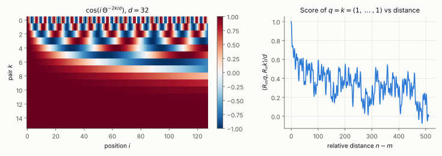

# 4. Rotary position embeddings

**Objective.** Give attention a sense of *where* tokens are, with rotary position embeddings (RoPE), the scheme used by Llama, Qwen, Mistral and most recent LLMs.

## Why positions?

Attention compares queries and keys with dot products $q_t^\top k_s$, which depend on the content at positions $t$ and $s$ but not on the positions themselves: a token cannot tell whether a key comes from the previous position or from 100 tokens ago.
(The causal mask leaks *some* positional information, since position $t$ attends to exactly $t$ tokens, but only indirectly.)
For language, order matters: "dog bites man" is not "man bites dog".

[GPT-2](https://cdn.openai.com/better-language-models/language_models_are_unsupervised_multitask_learners.pdf) (and nanoGPT) **add** a learned vector $p_t$ to the embedding of the token at position $t$.
This works, but it mixes "what" and "where" in the same vector, and the model has to learn from data that position 57 is close to position 58.

## Rotations

RoPE ([Su et al., 2021](https://arxiv.org/abs/2104.09864)) instead **rotates** the queries and keys by an angle proportional to their position.
In two dimensions, let $R(\alpha) = \begin{pmatrix} \cos\alpha & -\sin\alpha \\ \sin\alpha & \cos\alpha \end{pmatrix}$ and, for a query at position $m$ and a key at position $n$,

$$
q' = R(m\theta)\, q, \qquad k' = R(n\theta)\, k.
$$

Since rotations are orthogonal and $R(a)^\top R(b) = R(b - a)$,

$$
q'^\top k' = q^\top R(m\theta)^\top R(n\theta)\, k = q^\top R\big((n - m)\theta\big)\, k :
$$

the attention score only depends on the content ($q$, $k$) and on the **relative position** $n - m$.
Moreover, rotations preserve norms, so RoPE does not change the scale of the scores.

In dimension $d$ (even), we split the vector into $d/2$ pairs of coordinates $(x_{2k}, x_{2k+1})$, $k = 0, \dots, d/2 - 1$, and rotate pair $k$ at position $i$ by the angle

$$
\alpha_{i,k} = i \cdot \Theta^{-2k/d}, \qquad \Theta = 10\,000 .
$$

Each pair turns at its own frequency, from one radian per token ($k = 0$) to very slowly ($\Theta^{-(d-2)/d}$ radian per token, of the order of $10^{-4}$): fast pairs resolve nearby positions, slow pairs distinguish distant ones, much like the hands of a clock.

*Left: the cosine of the angle of each pair $k$ as a function of the position $i$, for $d = 32$. Right: the score between a query and a key both equal to $(1, \dots, 1)$, as a function of their distance $n - m$: it oscillates and decays with the distance.*

Concretely, with $c = \cos\alpha_{i,k}$ and $s = \sin\alpha_{i,k}$:

$$
\begin{pmatrix} x'_{2k} \\ x'_{2k+1} \end{pmatrix} = \begin{pmatrix} c & -s \\ s & c \end{pmatrix} \begin{pmatrix} x_{2k} \\ x_{2k+1} \end{pmatrix} = \begin{pmatrix} x_{2k}\, c - x_{2k+1}\, s \\ x_{2k}\, s + x_{2k+1}\, c \end{pmatrix}.
$$

There is no need to build $d \times d$ rotation matrices: with `x_even = x[..., 0::2]` and `x_odd = x[..., 1::2]`, both of shape `(..., T, d/2)`, the formula above becomes two element-wise expressions; then interleave the two results back with `torch.stack([even, odd], dim=-1).flatten(-2)`.

!!! tip "Visual explanations"
    - Christopher Fleetwood, [You could have designed state of the art positional encoding](https://huggingface.co/blog/designing-positional-encoding) (Hugging Face blog): from integer positions to sinusoidal embeddings to RoPE, with animations.
    - EleutherAI, [Rotary Embeddings: A Relative Revolution](https://blog.eleuther.ai/rotary-embeddings/): the intuition with complex numbers, and experiments comparing RoPE with other position embeddings.

## Implementation details

- RoPE has **no learnable parameter**. The angles only depend on the position and on the pair, so we precompute two tables `cos` and `sin` of shape `(max_seq_len, d/2)` once, in `__init__`, and store them with `self.register_buffer("cos", ..., persistent=False)`: buffers move with the module (`.to(device)`), and `persistent=False` keeps them out of the `state_dict` (no need to save them in checkpoints).
- `forward(x, token_positions)` selects the rows of the tables for the given positions: `self.cos[token_positions]` has shape `(T, d/2)` when `token_positions` has shape `(T,)`, which broadcasts against `x_even` and `x_odd`, of shape `(B, H, T, d/2)`.
- RoPE is applied to queries and keys, **not** to values, and to every head in the same way: the heads axis is just another batch dimension. So RoPE acts on vectors of size $d_h$ (the head dimension), not $d_\text{model}$.
- A single RoPE module can be shared by all layers (the `TransformerLM` of the next page does so).

!!! question "Exercise: `RotaryPositionalEmbedding`"
    Implement `RotaryPositionalEmbedding` in [`src/easygpt/attention.py`](https://github.com/svaiter/easygpt/blob/main/src/easygpt/attention.py):

    - `__init__(theta, d_k, max_seq_len)`: register the buffers `cos` and `sin`, of shape `(max_seq_len, d_k // 2)`, entry `[i, k]` being $\cos(i\, \Theta^{-2k/d_k})$ and $\sin(i\, \Theta^{-2k/d_k})$;
    - `forward(x, token_positions=None)`: rotate `x` of shape `(..., T, d_k)` (the default positions `0, ..., T-1` are given).

    Then, in `MultiHeadSelfAttention.forward`, apply `self.rope(q, token_positions)` and `self.rope(k, token_positions)` after splitting the heads, when `self.rope` is not `None`.

Validate with `uv run pytest tests/test_rope.py` (and re-run `tests/test_attention.py`).

## Questions

1. Prove that $R(a)^\top R(b) = R(b - a)$. Using complex numbers: identify the pair $(x_{2k}, x_{2k+1})$ with $z = x_{2k} + i\,x_{2k+1}$; what is the rotation? What is $\operatorname{Re}(z_q \overline{z_k})$? (This is how `tests/reference.py` implements the reference used by the tests.)
2. Why is it important that the *same* rotation is applied to all heads and all layers, and that values are not rotated?
3. What happens if you call the model on sequences longer than `max_seq_len`? Could RoPE work for positions it has never seen during training?
4. The wavelength of pair $k$ is $2\pi \Theta^{2k/d}$ tokens. For $d_h = 32$ and $\Theta = 10\,000$, what are the shortest and longest wavelengths? Compare with our context length $T = 128$.
