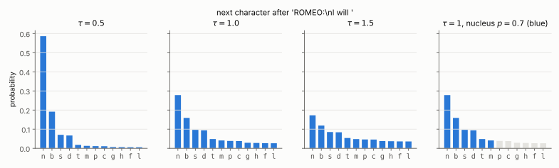

# 8. Generating text

**Objective.** Turn the trained model into a text generator: autoregressive decoding with temperature and nucleus (top-$p$) sampling.

## Autoregressive decoding

The model maps a sequence $x_{1:t}$ to logits for every position; the logits at the **last** position, $o_t$, define the distribution of the next token, $p(x_{t+1} \mid x_{1:t}) = \operatorname{softmax}(o_t)$.
To generate, start from a **prompt** and repeat:

1. feed the current sequence to the model (at most its last $T$ tokens: the model cannot see more than its context length);
2. take the logits of the last position, turn them into a distribution and draw a token from it;
3. append the token to the sequence; stop after `max_new_tokens` tokens, or when an end-of-text token is produced.

!!! note "Wasted computation"
    At each step, we recompute the forward pass for all the previous tokens, although only the last position is new. Real implementations keep a **KV cache** (the keys and values of the previous positions) and only compute the new position. See [Going further](../experiments.md).

## Temperature

Sampling from $\operatorname{softmax}(o)$ is not the only option.
Dividing the logits by a **temperature** $\tau > 0$ before the softmax,

$$
p_\tau(i) = \frac{\exp(o_i / \tau)}{\sum_j \exp(o_j / \tau)},
$$

sharpens the distribution when $\tau < 1$ (likely tokens become even more likely) and flattens it when $\tau > 1$.
In the limit $\tau \to 0$, we always pick the most likely token (**greedy** decoding); for $\tau \to \infty$ we sample uniformly.



*Next-character distribution of the trained Shakespeare model after `"ROMEO:\nI will "`, for several temperatures, and the nucleus kept by top-$p$ sampling with $p = 0.7$ (in blue; the grey tokens are dropped).*

## Nucleus (top-$p$) sampling

Even when the model is good, the long tail of unlikely tokens adds up to a non-negligible probability, and sampling one of them can derail the text.
**Nucleus sampling** ([Holtzman et al., 2020](https://arxiv.org/abs/1904.09751)) only keeps the smallest set $V^{(p)}$ of most likely tokens whose total probability is at least $p$, and renormalizes the (temperature-scaled) distribution $q$:

$$
P(x_{t+1} = i) = \begin{cases} \dfrac{q_i}{\sum_{j \in V^{(p)}} q_j} & i \in V^{(p)}, \\ 0 & \text{otherwise.} \end{cases}
$$

To compute $V^{(p)}$, sort the probabilities in decreasing order and keep a token if the cumulative probability *before* it is still below $p$ (so the most likely token is always kept).

!!! tip "Visual explanation"
    Patrick von Platen, [How to generate text](https://huggingface.co/blog/how-to-generate) (Hugging Face blog): greedy search, beam search, top-$k$ and top-$p$ sampling, illustrated on small trees of word probabilities.

!!! question "Exercise: `top_p_filter`, `sample_next_token`, `generate`"
    In [`src/easygpt/generate.py`](https://github.com/svaiter/easygpt/blob/main/src/easygpt/generate.py):

    - `top_p_filter(probs, top_p)`: zero out the probabilities outside the nucleus and renormalize. Use `torch.sort(probs, dim=-1, descending=True)` and `torch.cumsum`; to put the boolean "keep" mask back in the original order, use `scatter` (or `torch.gather` with the inverse permutation).
    - `sample_next_token(logits, temperature, top_p, generator)` for logits of shape `(B, V)`: argmax if `temperature == 0`; otherwise softmax of `logits / temperature`, top-$p$ filter if `top_p < 1`, and `torch.multinomial(probs, 1, generator=generator)`. Return token ids of shape `(B,)`.
    - `generate(model, prompt_ids, max_new_tokens, context_length, ...)`: the loop above, returning the list of *new* token ids (if `eos_id` is given and sampled, it is the last one). The decorator `@torch.no_grad()` is given.

Validate with `uv run pytest tests/test_sampling.py`.

## Generate

```bash
uv run easygpt generate checkpoints/shakespeare.pt --prompt "ROMEO:" --temperature 0.8 --top-p 0.95
```

```text
ROMEO:
The more is wisely dead to expect,
And get the recompense of the enemy.

KING HENRY VI:
How now, that's your ways and come are forth
And fair sorrow with the city is here.

PETRUCHIO:
Why, I cannot speak thee, in my knees, nor say,
I see the flesh will be confess in such body.
```

The effect of the temperature (without top-$p$):

=== "τ = 0 (greedy)"

    ```text
    ROMEO:
    The senate of the common that the straight,
    And then the prince that the straight of the
    The senators of the common of the common that they
    would have seen the season of the common soul, the
    ```

=== "τ = 0.5"

    ```text
    ROMEO:
    The more instructions of the hand, and good fathers
    Did I but weeping the good of his foe,
    That stands the reward to her side that we speak to
    the penitent of my highness and the brother from the for
    ```

=== "τ = 1"

    ```text
    ROMEO:
    Three medless sell it once expect,
    And gels them come with that here hath not so.

    First Gentleman:
    Who speaking we all: my fear'st not mother
    How speak on me, for our think the hands up the crown:
    ```

=== "τ = 1.5"

    ```text
    ROMEO:
    Pleash, dissons: temtory inexany you?
    Ignless greyhounds his twener? ha?

    DURAUM:
    Who! ignorances? at'on portily, Raatch: if
    't, ere's-day, stand we would for 'forious think; two ands up thus ne.S Ha
    ```

Greedy decoding is "safe" but repetitive (*the common*, *the straight*...); high temperatures invent words.
Values of $\tau$ between 0.7 and 1 with $p$ around 0.9–0.95 are a good compromise.

## Questions

1. Why does greedy decoding tend to loop and repeat itself?
2. Generate 20 samples with `--num-samples 20` and different prompts. Does the model copy whole passages of the training set? How could you check this systematically?
3. Top-$k$ sampling ([Fan et al., 2018](https://arxiv.org/abs/1805.04833)) keeps the $k$ most likely tokens. Why is top-$p$ often preferred? (Think of a position where the next character is almost certain, and of one where many characters are plausible.)
4. Write a function that computes the **log-likelihood** of a given text under the model. Compare `"To be, or not to be, that is the question"` with a shuffled version of its characters.
