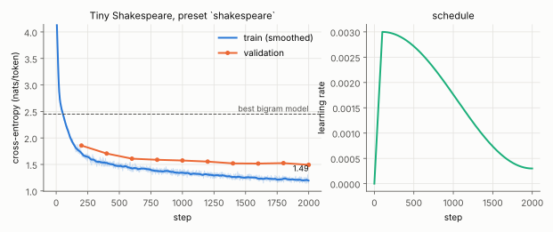

# 7. Training on Shakespeare

**Objective.** Write the training loop, the evaluation and the checkpointing, and train your Transformer on Tiny Shakespeare.

## Checkpoints

Training runs are long and can be interrupted. A **checkpoint** stores everything needed to resume: the model weights, the optimizer state (AdamW's moments!) and the iteration number (to resume the learning-rate schedule).
PyTorch makes this easy: `model.state_dict()` and `optimizer.state_dict()` return dictionaries (of tensors, mostly), restored with `load_state_dict`; `torch.save(obj, path)` and `torch.load(path)` serialize any dictionary of tensors and plain Python objects.

!!! question "Exercise: `save_checkpoint` and `load_checkpoint`"
    In [`src/easygpt/train.py`](https://github.com/svaiter/easygpt/blob/main/src/easygpt/train.py):

    - `save_checkpoint(model, optimizer, iteration, out, extra=None)` saves a dictionary with the keys `"model"`, `"optimizer"` (`None` if `optimizer` is `None`), `"iteration"` and `"extra"` (the `extra` dictionary, or `{}`); `out` is a path or a file-like object.
    - `load_checkpoint(src, model, optimizer=None)` restores the model (and the optimizer, if given) and returns the iteration. Use `torch.load(src, map_location="cpu")` so that a checkpoint saved on a GPU can be read on a CPU.

    The test checks that training for 5 steps, saving, restoring into a *fresh* model and optimizer, and training for 5 more steps gives exactly the same weights as 10 uninterrupted steps.

## Evaluation

The training loss is measured on the batches we optimize on; to detect **overfitting**, we also need the loss on held-out data (the last 10% of the text).
Computing it on the whole validation set at each evaluation would be slow, so we average the loss over a few random batches: a noisy but cheap estimate.

!!! question "Exercise: `evaluate`"
    Implement `evaluate(model, data, batch_size, context_length, num_batches, device, generator)` in [`src/easygpt/train.py`](https://github.com/svaiter/easygpt/blob/main/src/easygpt/train.py): the average cross-entropy over `num_batches` batches drawn with `get_batch`, as a Python float.
    The `@torch.no_grad()` decorator (given) disables the recording of the computation graph: it is faster and saves memory.

## The training loop

!!! question "Exercise: `train`"
    Complete `train(model, train_data, val_data, config, context_length)` in [`src/easygpt/train.py`](https://github.com/svaiter/easygpt/blob/main/src/easygpt/train.py).
    The setup is given: it moves the model to `config.device` (stored in `device`) and creates your `AdamW` optimizer, the `history` dictionary, the random generator `data_gen` and a helper `run_eval(step)` that evaluates on `val_data`, prints and records the result.
    For each `step` in `range(config.max_steps)`:

    1. set `group["lr"]` of every parameter group of the optimizer to `lr_cosine_schedule(step, config.lr_max, config.lr_min, config.warmup_steps, config.max_steps)`;
    2. draw a batch with `get_batch(train_data, config.batch_size, context_length, device, data_gen)`;
    3. compute the logits and the loss, `zero_grad`, `backward`;
    4. clip the gradients to `config.grad_clip` with your `clip_grad_norm`, then `optimizer.step()`;
    5. append `step`, `loss.item()` and `lr` to `history["step"]`, `history["train_loss"]`, `history["lr"]`; if `log` is true, print the loss every `config.log_interval` steps;
    6. call `run_eval(step)` every `config.eval_interval` steps (for `step > 0`).

    After the loop, call `run_eval(config.max_steps)` one last time.

Validate with `uv run pytest tests/test_training.py`: among other things, it trains a tiny model on the sequence `0 1 2 3 4 0 1 2 3 4 ...`, which it should learn almost perfectly in 60 steps (validation loss below 0.1).

## Train!

The `easygpt train` command (given, in [`src/easygpt/cli.py`](https://github.com/svaiter/easygpt/blob/main/src/easygpt/cli.py)) loads the data, builds a `TransformerLM` from a **preset** of [`src/easygpt/config.py`](https://github.com/svaiter/easygpt/blob/main/src/easygpt/config.py), calls your `train`, saves a checkpoint and prints a sample:

```bash
uv run easygpt train --preset shakespeare
```

The `shakespeare` preset is a model with $d = 128$, 4 layers, 4 heads, $d_\text{ff} = 384$, context $T = 128$ (0.87M parameters), trained for 2000 steps with batches of 32 sequences, AdamW ($\beta = (0.9, 0.95)$, weight decay 0.1), learning rate $3 \cdot 10^{-3}$ with 100 warmup steps and cosine decay to $3 \cdot 10^{-4}$, clipping at 1.
On a laptop CPU it takes 5 to 7 minutes (here on 4 cores):

```text
model: {'vocab_size': 65, 'context_length': 128, 'd_model': 128, 'num_layers': 4, 'num_heads': 4, 'd_ff': 384, 'rope_theta': 10000.0}
parameters: 869,760 (861,440 non-embedding)
train tokens: 1,003,854 | val tokens: 111,540
step      0 | train loss 4.7659 | lr 0.00e+00
step     50 | train loss 2.4836 | lr 1.50e-03
step    100 | train loss 2.0963 | lr 3.00e-03
...
step   1000 | val loss 1.5744 | val ppl     4.83 |   169.7s
...
step   2000 | val loss 1.4930 | val ppl     4.45 |   386.9s
saved checkpoints/shakespeare.pt
```



*Training and validation loss of the `shakespeare` preset (left), and learning rate (right). The dashed line is the training loss of the best possible bigram model (2.45, page 2).*

The loss goes from 4.77 at initialization to a validation loss of about **1.49** (perplexity 4.5: on average, the model is as uncertain as a uniform choice among 4 or 5 characters), far below the bigram model of page 2 (2.48 on validation).
Notice the gap between the training and validation losses that opens in the second half: with 1M characters of text and 0.87M parameters, the model starts to **overfit** (memorize the training set).

The sample at the end already looks like a play:

```text
MENENIUS:
Mark me, that she dost not me with kill'd,
Each of the time to the ground of grey in all
Like horse this commanded to how he is dear, stirr steed,
I'll speak thou to do thyself is to myself?

GLOUCESTER:
Sirrah, the Caius Aufidius, the soul of the deed,
```

Character names in capitals followed by a colon, line breaks, verse-like lines, real words, plausible names (Menenius and Aufidius are characters of *Coriolanus*, which is in the training set): all of this was learned from scratch, character by character, in a few minutes.

!!! tip "Options"
    `uv run easygpt train --help` lists the options: `--max-steps`, `--batch-size`, `--lr-max`, `--device`, `--seed`, `--no-rope`, `--compile` (`torch.compile`, faster after a slow start), `--out`.
    The history of the run is saved next to the checkpoint, in `checkpoints/shakespeare.json`, so that you can plot your own curves.

!!! info "On a Colab GPU"
    The `shakespeare-gpu` preset ($d = 384$, 6 layers, 6 heads, $T = 256$, 10.7M parameters, 5000 steps of batch 64) is close to the nanoGPT Shakespeare configuration: `easygpt train --preset shakespeare-gpu`.
    Its hyperparameters have not been tuned yet: watch the gap between the training and validation losses (a 10M-parameter model quickly overfits 1M characters; adding dropout is a good extension).

## Debugging a training run

If your loss does not go down (or if the tests of this page pass but training goes badly):

- **Check the loss at initialization**: about $\log V$ (here between 4.2 and 5). A much larger value means a bug in the initialization or the loss.
- **Overfit a single batch**: train on the same batch again and again; the loss should quickly get close to 0. If not, there is a bug in the model or the optimizer.
- **Reduce the learning rate**: if the loss explodes or becomes `nan`, try a learning rate 10 times smaller.
- **Monitor the gradient norm** (returned by `clip_grad_norm`): spikes indicate instabilities.
- **Shapes**: set breakpoints (or print) and check the shapes of the intermediate tensors.

## Questions and experiments

1. Plot the training and validation curves from `checkpoints/shakespeare.json`. When does overfitting start?
2. **Learning rate.** Run the preset with `--lr-max` in $\{3\cdot 10^{-4}, 10^{-3}, 3\cdot10^{-3}, 10^{-2}, 3\cdot10^{-2}\}$ (with `--max-steps 1000` to save time). Plot the final validation loss against the learning rate. Folk wisdom says the best learning rate is "at the edge of stability": is it close to the largest learning rate that does not diverge?
3. **Batch size.** Try `--batch-size 8` and `--batch-size 128` (adapt the number of steps so that the number of tokens seen, `batch_size × max_steps × context_length`, stays the same). What do you observe, in terms of loss and wall-clock time?
4. How does our model compare with the nanoGPT CPU baseline ($d = 128$, 4 layers, context 64, val loss about 1.88 after 2000 iterations of batch 12)? Which of our changes do you think matter most?
