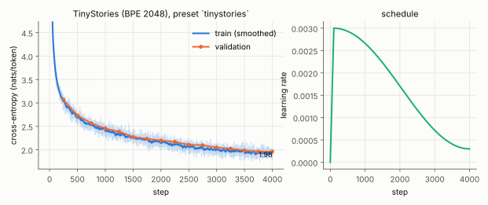

# 11. Training on TinyStories

**Objective.** Train a Transformer on BPE tokens, generate short stories, and compare with the character-level model.

There is nothing new to implement on this page: everything you wrote in Part I works on any sequence of token ids. Only the data changes.

## The data

After `uv run easygpt download tinystories` and `uv run easygpt tokenize` ([page 9](bpe-training.md) and [page 10](tokenizer.md)), the folder `data/tinystories/` contains:

- `tokenizer.json`: your BPE tokenizer (2048 tokens, `<|endoftext|>` is the last one, id 2047);
- `train.npy`: about 10.8M tokens (40 MB of text, about 50,000 stories), stored as `uint16`;
- `valid.npy`: about 1.1M tokens (4 MB of text).

The stories are separated by `<|endoftext|>` and form one long sequence, from which `get_batch` samples windows that may straddle two stories: the model learns that after `<|endoftext|>` a new, unrelated story begins.

## The model

The `tinystories` preset:

| | `shakespeare` | `tinystories` |
|---|---|---|
| tokens | 65 characters | 2048 BPE tokens |
| $d$ / layers / heads / $d_\text{ff}$ | 128 / 4 / 4 / 384 | 192 / 4 / 6 / 512 |
| context $T$ | 128 characters (~25 words) | 128 tokens (~100 words) |
| parameters | 0.87M | 2.56M (of which 0.79M in embedding and LM head) |
| steps × batch | 2000 × 32 | 4000 × 32 (16M tokens, 1.5 epochs) |
| time on a 4-core CPU | ~6 min | ~25 min |

With BPE, the same context length of 128 tokens covers about 470 characters, almost four times more text than the character-level model: enough for a good part of a story.

!!! info "Why such a short context?"
    On a CPU, a training step with $T = 256$ was 3.5 times slower than with $T = 128$ for this model, although it processes only twice as many tokens: the $T \times T$ attention matrices (per head and per layer) grow quadratically and dominate the extra cost.
    On a GPU, use the `tinystories-gpu` preset ($d = 384$, 6 layers, $T = 256$, 12.2M parameters).

## Train

```bash
uv run easygpt train --preset tinystories
```

```text
model: {'vocab_size': 2048, 'context_length': 128, 'd_model': 192, 'num_layers': 4, 'num_heads': 6, 'd_ff': 512, 'rope_theta': 10000.0}
parameters: 2,557,632 (2,164,416 non-embedding)
train tokens: 10,840,924 | val tokens: 1,084,034
step      0 | train loss 7.7180 | lr 0.00e+00
step     50 | train loss 4.6224 | lr 1.50e-03
step    100 | train loss 3.5467 | lr 3.00e-03
...
step   1000 | val loss 2.4538 | val ppl    11.63 |   339.6s
...
step   2000 | val loss 2.1987 | val ppl     9.01 |   732.0s
...
step   3000 | val loss 2.0473 | val ppl     7.75 |  1089.5s
...
step   4000 | val loss 1.9618 | val ppl     7.11 |  1424.6s
saved checkpoints/tinystories.pt
```



*Training and validation loss of the `tinystories` preset (left), and learning rate (right).*

The initial loss, 7.72, is close to $\log 2048 = 7.62$, and the validation loss reaches **1.96** after 4000 steps (about 24 minutes here).
The training and validation losses stay close: with 1.5 epochs over the data, the model does not overfit. It is limited by compute, not by data: the loss is still decreasing, and more steps (or a GPU) would help.

## Generate

```bash
uv run easygpt generate checkpoints/tinystories.pt --prompt "Once upon a time" --temperature 0.8 --top-p 0.95
```

Generation stops at `<|endoftext|>`, the end of the story.

```text
Once upon a time, there was a friendly cat named Tom. Tom loved to play with his ball. He had many friends in the park. One day, Tom saw a big box of milk on the ground. He thought it would be fun to put the ball inside the box.
Tom's friend, Sue, came to play. They played together, and Tom felt happy. Tom was a good boy. They played hide and seek all day long. They had so much fun, and they decided to play with the milk.
<|endoftext|>
```

And with `--prompt "Lily and Ben"`:

```text
Lily and Ben looked at each other. They were very surprised. The cake made a yummy cake for them. They took the cake to the kitchen and gave it to the cat. Lily was very happy. She said, "Thank you, mom, for making cookies!"
<|endoftext|>
```

The grammar is almost always correct, the vocabulary and style are those of TinyStories, and there are names, dialogues and a story structure ending with `<|endoftext|>`. But the logic is shaky ("The cake made a yummy cake", "Tom was a good boy" for a cat): with 2.6M parameters and 16M training tokens, the model has learned the *form* of the stories much better than their *content*. The TinyStories paper ([Eldan & Li, 2023](https://arxiv.org/abs/2305.07759)) shows that models of a few tens of millions of parameters, trained on the full dataset, are remarkably coherent.

## Comparing tokenizations: bits per byte

The losses of the two models are not comparable: one is per character, the other per BPE token, which covers 3.7 bytes on average.
To compare, convert the loss into **bits per byte** (bpb): the number of bits the model needs, on average, to encode one byte of text,

$$
\text{bpb} = \frac{\text{loss (nats per token)}}{\ln 2 \times \text{bytes per token}}.
$$

For our two models:

| | loss (nats/token) | bytes/token | bits per byte |
|---|---|---|---|
| `shakespeare` (characters) | 1.49 | 1 | 2.15 |
| `tinystories` (BPE 2048) | 1.96 | 3.69 | 0.77 |

TinyStories is much easier to predict than Shakespeare (simple and repetitive language), so these two numbers say more about the datasets than about the tokenizers. To compare tokenizers, train both kinds of models on the *same* data (question 3 below).

## Questions and experiments

1. Generate 10 stories with different prompts (`"Once upon a time"`, `"Lily and Ben"`, `"The dog"`...). What does the model get right (grammar, names, dialogue, story structure)? What does it get wrong (long-range consistency, logic)?
2. Retrain the tokenizer with `--vocab-size 1024` and `4096`, retrain the model and compare in bits per byte (keep the number of steps fixed). What is the trade-off?
3. Train the character-level preset on TinyStories (hint: you will have to adapt `load_shakespeare` in the CLI). How does it compare in bits per byte and in quality of the stories, for the same training time?
4. We train on 40 MB of text, but how much of it has the model actually "seen"? How many epochs do 4000 × 32 × 128 tokens represent? Is the model overfitting? What does this suggest about the right amount of data for a 2.6M-parameter model?
